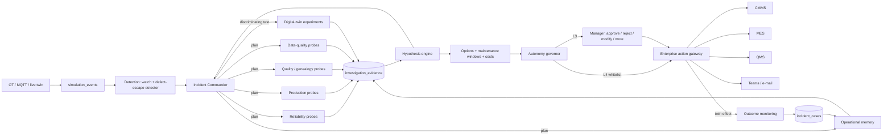
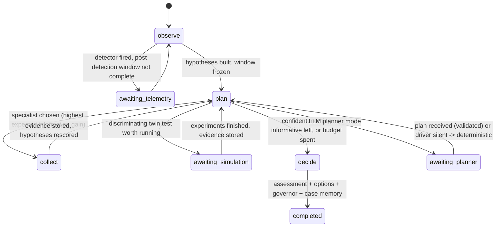

# Agent architecture — the Incident Commander (ADR-067)

PulseTwin's AI layer does four things. It **investigates** an incident by choosing which
evidence to gather next, **scores** competing root-cause hypotheses with a published rule,
**tests** interventions in the digital twin, and **routes** the result through an autonomy
governor to a human.

The LLM is optional. When one is configured it only *proposes* the next investigation step,
and deterministic code validates, executes, scores and decides.

## 1. The loop



## 2. The state machine



- **Code:** `serve/commander.py::advance` is one transition, serialised per investigation.
- **Persistence:** every transition persists `investigations.state`, the step row, the
  evidence rows and the `agent_runs` row.
- **Resuming after a restart:** the background advancer (`start_advancer`, one step per
  tick) picks up every investigation that is still active.

## 3. Specialists — one domain each, and not all of them every time

| Specialist | Probes (`serve/incident_evidence.py`) | Answers |
|---|---|---|
| production | `state_mix`, `cycle_time`, `neighbour_flow`, `variant_mix` | Is the station down, blocked or starved? Are its neighbours stalled? Did the mix change? |
| reliability | `signal_health`, `failure_history` | Do torque or weld current deviate from the per-variant baseline? Is there a breakdown history or a prior degradation case? |
| quality | `defect_rate`, `defect_trace`, `lot_concentration`, `manual_checklist`, `zone_climate` | Is the gate rate abnormal? Which station introduced the defects, and when? Is it a lot? Is a manual procedure rushed? Is the paint climate failing? |
| data_quality | `sensor_health`, `model_health` | Can the readings be trusted? Have the model inputs drifted? |
| memory | `similar_cases` | What happened the last times this looked the same, in any plant? |
| simulation | twin experiments (`offline/sim_experiment.py`) | Would the intervention that fits hypothesis H change the symptom? |

**How the next specialist is chosen.** The deterministic planner scores every unexecuted
(probe, station) pair by expected information gain:

    EIG = availability × Σ_h p_h (1 − p_h) × |max weight the probe can put on h|

It then picks the specialist whose top three requests carry the most EIG.

- **Availability:** a torque probe at a manual station has availability 0, so the commander
  asks for manual checklist records instead.
- **Poorly instrumented station:** when sensing is poor (LOW / UNKNOWN / MANUAL_ONLY), the
  first step is always data quality.
- **Mandatory checks:** `model_health` and the incident station's `sensor_health` must run
  before any decision.
- **Simulation:** runs only when a leading hypothesis has a catalogue intervention that
  would discriminate it. It does not run when "no fault" or "sensor fault" leads, when the
  model is degraded, or when the budget is spent.

## 4. Plans — structured, validated, never executed on trust

```json
{"goal": "identify the source of the S19 throughput loss",
 "next_agent": "production",
 "reason": "'S19 equipment degradation' (19%) vs 'Downstream congestion after S19' (19%) is unresolved; production evidence has the highest expected information gain (1.94)",
 "required_evidence": ["state_mix@19", "neighbour_flow@19", "variant_mix@19"],
 "expected_information_gain": "high",
 "stop_condition": "top hypothesis >= 80% or information gain < 0.02"}
```

`validate_plan` checks the following, in order:

1. A pydantic model with `extra="forbid"`.
2. No control characters.
3. `next_agent` is on the allowlist.
4. Every probe exists, belongs to that agent and applies to this incident kind.
5. Every station is inside the investigation's topological scope (±`station_scope_hops`,
   plus any traced candidates).
6. Nothing is re-collected.
7. Budgets hold: steps, probe calls, simulations, LLM tokens and cost, wall clock.
8. A simulation plan names only hypotheses the twin can test *now*.

An LLM plan that fails validation is recorded (`plan_valid=0`, `rejection_reason`) and the
deterministic plan runs in the same step.

## 5. Hypothesis scoring (the published rule)

Hypotheses for one incident are mutually exclusive, and "normal variation — no fault" is
always one of them.

    logit_h      = ln(prior_h) + Σ_e quality(e) × weight(e, h)
    confidence_h = softmax(logit)_h

- **Priors:** "no fault" starts at 0.10 when a detector fired and 0.30 for an operator
  report. The rest share the remainder equally.
- **Quality multipliers:** measured 1.0, simulated 0.8, inferred 0.6, manual 0.5,
  missing 0 (`configs/agentic.yaml`).
- **Weights:** each probe sets its weights from an effect size with a fixed rule, and every
  weight is persisted beside the number it came from.

| Evidence | Rule |
|---|---|
| state share (down / blocked / starved) vs recorded baseline | z ≥ 3 and share ≥ 15% → +min(2, z/3) for the matching cause; z < 1 → −0.6. A blocked station → −0.8 on "local degradation" (it is waiting, not slow). |
| torque / weld deviation from the per-variant baseline | ≥ threshold (8%, from the plant's watch rules) → +min(2, dev/8); < 4% → −1.0 |
| sensor completeness | < 60% → sensor fault +2.0; ≥ 95% with no dropouts → −1.5 |
| variant mix (chi-square z via Wilson–Hilferty) | z ≥ 2.33 and total variation ≥ 0.10 → support; z < 1.28 → −1.0 |
| defect trace (case-control t or exposure-split z) | ≥ 3 → +min(2, stat/3); < 2 → −0.8; a shift present since the run began → −0.8 |
| twin experiment on the symptom metric | paired 95% interval clears zero in the right direction → +1.5; wrong direction → −1.0; positive but uncertain → +0.3; no effect → −0.8 only if another arm recovered something, else 0 (inconclusive) |
| similar resolved case | +0.6 × similarity for its root cause, only if its outcome was successful |

**Statuses.**
- *supported*: ≥ 0.5 with support.
- *rejected*: < 0.05 with a contradiction.
- *weakened*: below its prior with a contradiction.
- *investigating*: touched by evidence but none of the above.
- *proposed*: untouched.
- *unresolved*: anything unsettled at decision time.

**Sensor-maturity cap.** Confidence can never exceed what the implicated station's sensing
supports: HIGH 0.95, MEDIUM 0.85, LOW 0.70, MANUAL_ONLY 0.65, UNKNOWN 0.50.

**Not calibrated.** A 0.8 means "the evidence favours this 4:1 under these weights". It is
not an 80% hit rate. See `docs/AI_EVALUATION.md`.

## 6. Abstention

`serve/hypotheses.py::assess` checks these in order and names the reason for each:

1. MODEL_DEGRADED — PSI past the block threshold.
2. SENSOR_UNRELIABLE — the implicated station's completeness is below 60%, unless the
   sensor itself is the diagnosis.
3. INSUFFICIENT_DATA — less than 50% of the evidence was measurable.
4. CONFLICTING_EVIDENCE — the top two are within 15 points and both have support.
5. LOW_CONFIDENCE — below 70% after the cap.
6. CONFIDENT — otherwise.

What happens next:
- CONFIDENT with "no fault" leading → `no_action`: no work order is raised.
- Any other non-confident state → `withheld`: only diagnostic options are offered (manual
  inspection, sensor calibration, notification, monitoring).

## 7. Sensor maturity and model drift

**Maturity.** Maturity is computed per station from the evidence window:
- MANUAL_ONLY: a manual tier.
- UNKNOWN: no telemetry.
- LOW: completeness below 60%.
- HIGH: at least 95% complete, under 20% inferred, and two or more sensors.
- MEDIUM: everything else.

The UI badges every evidence item as MEASURED, INFERRED, SIMULATED, MANUAL or MISSING.

**Drift.** Drift is measured on *stationary* transforms of the model inputs:
- torque, weld and film deviation from the station/variant mean;
- humidity and temperature *excess over ambient*.

Raw humidity follows the day's ambient cycle, so a 30-minute window always "drifted"
against a 24-hour baseline. That was measured the first time this ran: PSI 5.4 on a
normal run.

Each feature is judged against its own recorded envelope: the largest PSI any 15- or
30-minute window of the recorded day shows.
- **Warn:** PSI ≥ max(0.10, envelope).
- **Block:** PSI ≥ max(0.25, 1.5 × envelope).

## 8. Digital twin as a hypothesis test

**What the twin reproduces.** The twin reproduces the condition read from observed
evidence, not from the hypothesis under test: blocked share → `buffer_congestion`, down
share → `station_breakdown`, torque deviation → `torque_degradation`, humidity excess →
`high_humidity`.

**What each test measures.** It measures the station's symptom (blocked time for
congestion, downtime for a breakdown), not only line output. When the line's constraint is
elsewhere, line UPH cannot separate causes.

**Contract.** Seeds are paired against a baseline and intervals are bootstrapped. The
catalogue in `serve/experiment_catalog.py` bounds every intervention.

**Limitation, measured.** The replay transform scripts a blocked state; the physics twin
models congestion as reduced buffer capacity. On scenario A the twin therefore shows no
blocking change (+0.00). The commander records this as *inconclusive*, and the outcome
ledger records the resulting prediction error.

## 9. Temporal and topological tracing (quality incidents)

For defects found at the gate, the commander traces backwards over the run's own per-unit
event history (the genealogy). Two tests run for every station the defective units passed:

- **Case-control:** recent defective units' readings at the station vs units inspected good
  this run.
- **Exposure split:** the station's own shift onset (the first 8 consecutive readings past
  the threshold). Then the gate's defect rate for units that passed after the onset vs
  before (two-proportion z). A shift present since the run began cannot explain a burst
  that began later.

**Output:** the onset, the first defective unit's entry, the first defect observed, the
affected window, and the in-flight units that passed inside it (which feed the quality
hold).

## 10. Where the LLM is, and is not

| The LLM may | The LLM may not |
|---|---|
| read investigation state over HTTP (`genai/commander.py`) | call a probe, write a number, pick a confidence |
| propose one JSON plan per step | name a tool outside the allowlist (rejected: `unknown probe`) |
| explain in its `reason` field | reach approval, execution or any OT system |

The narrative `incident` intent (ADR-045 orchestrator + verifier) is unchanged. It answers
"tell me about this" in prose, verified claim by claim. The commander answers "what do we
do", in state.
