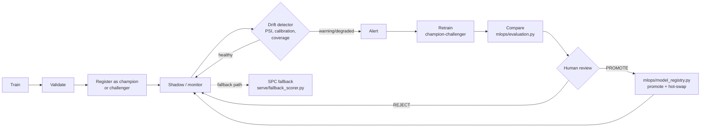

# MLOps Lifecycle

Answers "how do you know when the model is wrong?" — the finals judges' second question.
Every stage below names the file that implements it; nothing is aspirational without
saying so.

## Lifecycle

## Stage 1 — Train

`offline/ml/train.py` (existing pipeline, unchanged by the finals upgrade) fits a
HistGradientBoosting model with Platt calibration on the featurised, time-split data
(`offline/ml/featurize.py`, ADR-010's timestamp-based leakage guard). `mlops/retrainer.py`
calls the same `train_module.run(...)` a human or `make retrain` would — the champion and
every challenger are trained by the identical code path, never a divergent "production"
variant.

## Stage 2 — Validate

Temporal cross-validation metrics (`pr_auc`, `thresholds.precision_at_budget`,
`thresholds.recall_at_budget`, `reliability` bins for calibration) are written to
`metrics.json` by the training run itself — this is the existing Round-2 pipeline, not
new.

## Stage 3 — Register

`mlops/model_registry.py::register()` inserts a row into `model_registry`
(`migrations/003`) with `status='champion'` (first model for a plant, bootstrapped
unconditionally — `mlops/retrainer.py`'s bootstrap branch) or `status='challenger'` (every
subsequent retrain). Exactly one champion per `(plant_id, model_type)` is enforced by
`admin.py::promote_model`/`rollback_model`'s retire-then-promote sequencing, not a
database constraint — see `docs/DECISIONS.md` ADR-034 for why a real Postgres FK, added
for this finals round, is trusted over an implicit invariant wherever one exists.

## Stage 4 — Shadow / monitor

The **champion** serves live predictions (`serve/scorer.py`, `/api/predict/defect`). A
**fallback** SPC scorer (`serve/fallback_scorer.py`, single 3-sigma rule) runs
continuously in shadow — its predictions are logged, never surfaced, unless the primary
model fails to score (a corrupt/incompatible `.npz`), in which case the response is
labelled `"FALLBACK MODE"` in plain text so the UI never presents a fallback number as
though the real model spoke. **Shadow precision/recall are reported as measured, with no
floor** — see `docs/DECISIONS.md` ADR-035: the textbook 8-rule Nelson battery scores
3.0%/100% precision/recall against this line's genuinely autocorrelated physics, which is
exactly why the live fallback path deliberately implements only the single 3-sigma rule,
not the full battery.

`mlops/drift_detector.py` runs periodically (`python -m mlops.drift_detector --config
configs/plant_a.yaml`, or `make drift-check`) and writes to `drift_metrics`
(`migrations/004`):

| Metric | Threshold | What it means |
|---|---|---|
| PSI, per top-20-SHAP feature | warn > 0.1, alert > 0.2 | Has the serving-time feature distribution moved away from training? |
| Calibration deviation | alert > 15pp | In any prediction decile, does predicted risk still match observed defect rate? |
| Sensor coverage | alert if full-coverage fraction drops > 5pp vs training | Is the model now receiving worse-instrumented data than it was trained on? |

**Stated honestly, not glossed over:** this system replays a fixed simulated dataset, not
a live incoming stream. "Current" in the table above is the model's own held-out test
split (ordered by `prediction_ts`, most recent 500 units); "reference" is the training
split. That is a real, answerable drift question — does serving-time data still look like
training-time data — computed from what actually exists, not a placeholder. **Once a
genuinely live feed exists** (`ingestion/` running against a real MQTT source), `current`
becomes a real rolling window sourced from `station_readings` instead of a parquet split;
nothing else in the pipeline changes, because `drift_metrics`, `/api/model/health`, and
`DriftMonitor.tsx` already consume whatever `drift_detector.py` writes without caring
where the rows came from.

`GET /api/model/health` is the single read surface for all of the above — champion
identity/age, drift summary, fallback shadow stats, sensor coverage — rendered live in
`ModelHealthPanel.tsx` and `DriftMonitor.tsx` on the Ops view.

## Stage 5 — Retrain (champion-challenger)

Triggered manually (`make retrain`), on a schedule (a cron calling the same command — not
built as a scheduler in this repo, per the anti-pattern guidance against Airflow/Kubeflow
for a piece this size), or over the API (`POST /api/admin/trigger-retrain`, `system` role
only, spawns `python -m mlops.retrainer` as a **detached subprocess** — `serve/` never
imports `mlops`, which pulls in pandas/sklearn transitively and would breach the import
wall, ADR-036). The challenger trains with a deliberately different, documented
hyperparameter set (`mlops/retrainer.py`'s `CHALLENGER_HYPERPARAMS`) — CLAUDE.md's "seed
42 everywhere" rule rules out manufacturing a difference by varying `random_state`, so the
difference has to be a real configuration choice.

**Recommended cadence:** monthly scheduled, plus triggered immediately on any `degraded`
drift alert. There is no evidence in this project to size a different cadence against —
this is a stated policy, not a measured optimum, and is flagged as such.

## Stage 6 — Compare

`mlops/evaluation.py::compare()` — the promotion rule is **all three, not a weighted
average**, so one worse metric cannot hide behind two better ones:

1. Challenger PR-AUC strictly greater than champion's.
2. Challenger precision-at-budget greater than or equal to champion's.
3. Challenger's max calibration deviation less than or equal to champion's.

`recommendation: "PROMOTE"` only if all three hold; otherwise `"REJECT"`.
`requires_human_approval: true` unconditionally — the pipeline never self-promotes past
the bootstrap case (no prior champion for a plant).

## Stage 7 — Human review and promotion

`RetrainingConsole.tsx` on the Ops view renders the full comparison (`system` role,
gated by `RoleGate`) with **Promote Challenger** / **Reject** actions.
`POST /api/admin/promote-model` retires the current champion and promotes the challenger
in one call, logs `model_promoted` to the audit trail with the approving role, and is the
only code path that changes what `/api/predict/defect` actually serves. **Reject** has no
backend mutation — an un-promoted challenger already has zero effect on serving, so
"rejecting" it is a client-side dismissal of the review, not an undo of anything.

**Shadow period before promotion:** minimum 1 week of shadow monitoring in a real
deployment before a challenger is eligible for promotion review, even if `compare()`
recommends PROMOTE immediately after training — a single comparison against one held-out
split is necessary but not sufficient evidence that a model behaves well against a live
population. Not enforced in code in this build (the demo has no live population to shadow
against for a week); stated here as the policy a production rollout would gate on.

## Rollback

`POST /api/admin/rollback-model` (`system` role): retires the current champion and
restores the most recently retired one for that `(plant_id, model_type)`. One call, no
retraining involved — this is the "the model doesn't just predict, it predicts when it
CAN'T predict, and someone can act on that in one click" story for a judge asking "what
if the new model is actually worse."

**Trigger for a manual rollback:** sustained precision below 60% for two consecutive
weeks of live feedback (mirrors `docs/CHANGE_MANAGEMENT.md`'s rollback plan), or a
`degraded` drift status that a retrain does not resolve.

## Model retirement

Models older than 6 months, and any model retired by a promotion or rollback more than
6 months ago, are archived: `model_registry.status` moves from `retired` to no further
transition (there is no `archived` status enum value in `migrations/003` — this is a
stated retention policy for the artifact files on disk, `.npz` deletion after 6 months
past retirement, not a database state machine this build implements).
