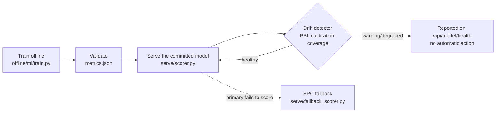

# MLOps Lifecycle

Answers "how do you know when the model is wrong?" Every stage below names the file that
implements it; nothing is aspirational without saying so.

**Retraining was removed (ADR-053).** The data this system learns from is a static
simulation, generated with seed 42 and deterministic end to end (`OMP_NUM_THREADS=1`,
ADR-016). A retrain over the same data reproduces the deployed model exactly, so the
champion-challenger pipeline (`mlops/retrainer.py`, `mlops/evaluation.py`, the
`/api/admin/*` promote/rollback endpoints and the Ops-view retraining console) could only
ever re-derive what is already serving. What remains is training once, offline, and
**read-only monitoring**.

## Lifecycle

## Train

`offline/ml/train.py` fits a HistGradientBoosting model with Platt calibration on the
featurised, time-split data (`offline/ml/featurize.py`, ADR-010's timestamp-based leakage
guard), and `offline/build_artifact.py` bakes it to `artifacts/model_<plant>.npz` for the
numpy scorer. `make train` rebuilds it; the nightly workflow regenerates the whole pipeline
and flags any headline metric that moved.

## Validate

Temporal cross-validation metrics (`pr_auc`, `thresholds.precision_at_budget`,
`thresholds.recall_at_budget`, `reliability` bins for calibration) are written to
`metrics.json` by the training run itself.

## Register and serve

At startup `serve/main.py` loads the committed `model_<plant>.npz` and records it in
`model_registry` as the plant's champion, with its real measured metrics
(`_bootstrap_registry_champion`), plus the SPC fallback. With no promotion path, a registry
row can describe the served model but can never select a different one.

## Monitor (read-only)

A **fallback** SPC scorer (`serve/fallback_scorer.py`, single 3-sigma rule, baselines
exported offline by `mlops/fallback.py`) runs in shadow — its predictions are logged, never
surfaced, unless the primary model fails to score, in which case the response is labelled
`"FALLBACK MODE"` in plain text. Shadow precision/recall are reported as measured, with no
floor (ADR-035).

`mlops/drift_detector.py` is run offline (`make drift-check`) and writes to `drift_metrics`
(`migrations/004`):

| Metric | Threshold | What it means |
|---|---|---|
| PSI, per top-20-SHAP feature | warn > 0.1, alert > 0.2 | Has the serving-time feature distribution moved away from training? |
| Calibration deviation | alert > 15pp | In any prediction decile, does predicted risk still match observed defect rate? |
| Sensor coverage | alert if full-coverage fraction drops > 5pp vs training | Is the model now receiving worse-instrumented data than it was trained on? |

"Current" is the model's own held-out test split (most recent 500 units by
`prediction_ts`); "reference" is the training split. `GET /api/model/health` is the single
read surface — champion identity/age, drift summary, fallback shadow stats, sensor
coverage — rendered in `ModelHealthPanel.tsx` and `DriftMonitor.tsx` on the Ops view. A
drift warning there is information for a person, not a trigger: there is nothing to
retrain *on* until the data itself changes.

## If the data ever becomes live

Retraining becomes meaningful again only when the training data can change — a real MQTT
feed through `ingestion/` writing `station_readings`. Reintroducing it then is a new
decision (a new ADR), not a revert of ADR-053.
