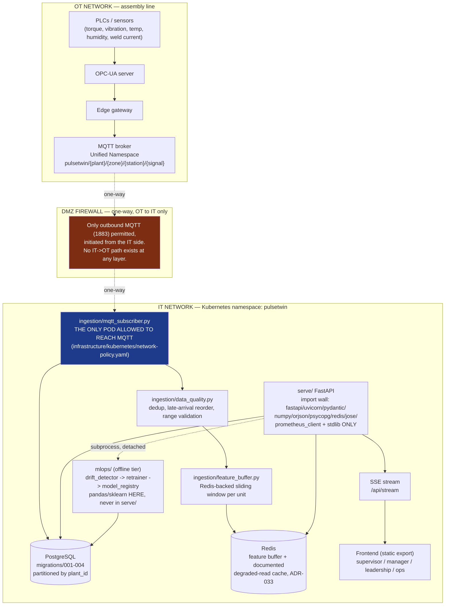

# Production Architecture

`docs/ARCHITECTURE.md` describes the Round-2 prototype's ISA-95 placement and states its
posture plainly: "this deployment is a demo, and its posture is not production." This
document is the finals-upgrade answer to that gap — the same read-only twin, with a real
ingestion path, RBAC, an audit trail, and a deployment story an enterprise IT/OT team
would actually sign off on. It does not replace `ARCHITECTURE.md`; it extends it upward
from "the serving layer is honest about what it computes" to "here is how this reaches a
real plant network without opening a hole in it."

## The one-sentence version

**Data flows one way, OT → IT, through a single named bridge process. Nothing in `serve/`
ever dials the OT network, and nothing in the whole namespace dials the public internet.**

## Diagram

## Key properties, and where each is enforced

| Property | Enforced by |
|---|---|
| One-way OT → IT data flow | `ingestion/mqtt_subscriber.py` never publishes to MQTT, only subscribes; no code path writes back |
| `ingestion` is the only OT/IT bridge | `infrastructure/kubernetes/network-policy.yaml` policies 2 and 5 (egress from ingestion to mqtt; ingress to mqtt from ingestion only) |
| `serve/` cannot reach MQTT even if compromised | Not a missing feature — `paho-mqtt` is never on `serve/`'s import allowlist (ADR-033), and `network-policy.yaml` policy 3 gives the backend pod no egress rule to the broker at all |
| No internet egress from the data plane | `configs/deployment.yaml` `network.internet_egress_allowed: false`; `infrastructure/terraform/main.tf`'s VPC module has no NAT gateway on the private subnets |
| Encryption in transit | TLS terminated at the ingress/load balancer (not modelled in Compose); MQTT would run TLS-wrapped (8883) in a real OT bridge, not the plaintext 1883 this demo uses locally |
| Encryption at rest | `infrastructure/terraform/main.tf`'s `aws_db_instance` sets `storage_encrypted = true` |
| No model library in the runtime image | `tests/test_serve_imports.py` — `pandas`/`sklearn`/`xgboost`/`shap`/`scipy` are BANNED, not merely unused |
| Config-driven scaling | `configs/deployment.yaml` is the single source of replica counts/resources that both `infrastructure/kubernetes/*.yaml` and this document's numbers are copied from |

## Runtime topology (what actually runs where)

| Component | Demo runtime (docker-compose.prod.yml) | Production target (infrastructure/kubernetes/) |
|---|---|---|
| Backend | 1 container, `uvicorn --workers 1` (ADR-009: async SSE needs the single-worker event loop) | 2-6 pods behind a Service, HPA on CPU (`hpa.yaml`) |
| Ingestion | 1 container | 1 pod, fixed at 1 replica (`configs/deployment.yaml`: MQTT shared-subscription scaling is a backlog item, not built) |
| Postgres | 1 container, ephemeral volume | Managed RDS/Cloud SQL, Multi-AZ (`terraform/main.tf`), or `postgres-statefulset.yaml` for a self-hosted cluster |
| Redis | 1 container | `redis-deployment.yaml`, single instance (feature buffer only; not a HA requirement for a cache) |
| MQTT | Eclipse Mosquitto, plaintext, local | `mqtt-deployment.yaml`; production would add TLS + broker-level ACLs restricting which topics the edge gateway may publish to |
| Frontend | Static export served by its own container (`frontend/Dockerfile`) | Same static export, ideally behind a CDN — it is not a stateful service and does not belong inside the Kubernetes data-plane trust boundary |

## What is deliberately NOT built (and why that is not a gap)

Per the finals brief's own anti-pattern list: no live Kubernetes deployment (`docker-compose.prod.yml` is the demo runtime), no Airflow/Kubeflow for `mlops/retrainer.py` (a plain script that runs end to end is the honest amount of infrastructure for a manually- or cron-triggered monthly retrain), no in-demo Grafana (the Ops view, `frontend/app/ops/page.tsx`, reads the same underlying numbers directly from the API). `infrastructure/terraform/main.tf` is never `terraform apply`'d — see that file's own header.
