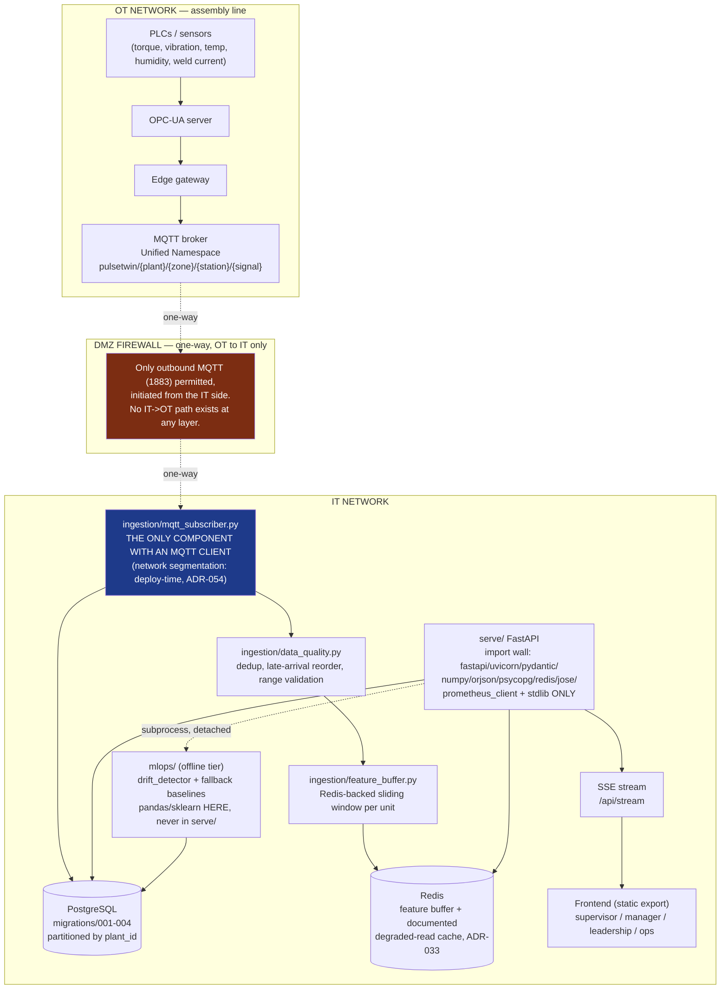

# Production Architecture

`docs/ARCHITECTURE.md` describes the Round-2 prototype's ISA-95 placement and states its
posture plainly: "this deployment is a demo, and its posture is not production." This
document is the finals-upgrade answer to that gap — the same read-only twin, with a real
ingestion path, RBAC, an audit trail, and a deployment story an enterprise IT/OT team
would actually sign off on. It does not replace `ARCHITECTURE.md`; it extends it upward
from "the serving layer is honest about what it computes" to "here is how this reaches a
real plant network without opening a hole in it."

## The one-sentence version

**Data flows one way, OT → IT, through a single named bridge process. Nothing in `serve/`
ever dials the OT network, and nothing in the whole namespace dials the public internet.**

## Diagram



## Key properties, and where each is enforced

| Property | Enforced by |
|---|---|
| One-way OT → IT data flow | `ingestion/mqtt_subscriber.py` never publishes to MQTT, only subscribes; no code path writes back |
| `ingestion` is the only OT/IT bridge | Code: `ingestion/` is the only deployable with an MQTT client. **Not network-enforced in this repo** — the Kubernetes NetworkPolicy drafted for it was never applied and was removed (ADR-054); a real plant network must enforce it at deploy time |
| `serve/` cannot reach MQTT even if compromised | `paho-mqtt` is never on `serve/`'s import allowlist (ADR-033), so the backend has no MQTT client code; network-level denial is the same deploy-time requirement as above |
| No internet egress from the data plane | Design intent (`configs/deployment.yaml` `network.internet_egress_allowed: false`); not enforceable on Render's free tier, which is internet-facing by design |
| Encryption in transit | TLS terminated at the ingress/load balancer (not modelled in Compose); MQTT would run TLS-wrapped (8883) in a real OT bridge, not the plaintext 1883 this demo uses locally |
| Encryption at rest | Neon encrypts storage at rest; the connection string's `sslmode=require` encrypts every database connection in transit |
| No model library in the runtime image | `tests/test_serve_imports.py` — `pandas`/`sklearn`/`xgboost`/`shap`/`scipy` are BANNED, not merely unused |
| Config-driven scaling | `configs/deployment.yaml` holds the sizing intent this document's numbers are copied from |

## Runtime topology (what actually runs where)

Every deployment runs on **Postgres** (ADR-052): `PULSETWIN_REQUIRE_POSTGRES=1` makes a
missing `DATABASE_URL` a startup failure. SQLite (`artifacts/pulsetwin.db`) is the build
output `offline/load_to_postgres.py` loads, and the test backend — never a runtime.

| Component | Local stack (`make up`, docker-compose.prod.yml) | Free-tier cloud (render.yaml + Neon + Vercel) | Scaled design (not built; sizing in `configs/deployment.yaml`) |
|---|---|---|---|
| Backend | 1 container, `uvicorn --workers 1` (ADR-009: async SSE needs the single-worker event loop) | 1 Render free web service, same image, pool capped at 5 | 2-6 replicas behind a load balancer, autoscaled on CPU |
| Ingestion | 1 container | **not deployed** (no MQTT TLS/auth yet) | 1 replica (MQTT shared-subscription scaling is a backlog item, not built) |
| Postgres | 1 container, named volume | Neon free project, **direct** (non-pooled) connection | Managed Postgres (RDS/Cloud SQL), Multi-AZ, one instance per plant |
| Redis | 1 container | **not deployed** (`serve/` never imports redis; `/api/health` reports `not_configured`) | Single managed instance (feature buffer only; not an HA requirement for a cache) |
| MQTT | Eclipse Mosquitto, plaintext, local | **not deployed** (`/api/health` reports `not_configured`) | Managed/hardened broker with TLS (8883) and broker-level topic ACLs for the edge gateway |
| Frontend | Static export served by its own container (`frontend/Dockerfile`) | Vercel, static export with clean URLs (`frontend/vercel.json`) | Same static export behind a CDN — not a stateful service, and outside the data-plane trust boundary |

## What is deliberately NOT built (and why that is not a gap)

Per the finals brief's own anti-pattern list: no live Kubernetes deployment (`docker-compose.prod.yml` is the local runtime, `render.yaml` the free-tier cloud one), no retraining pipeline at all — retraining was removed because the training data is a static seed-42 simulation that a retrain would only reproduce (ADR-053), no in-demo Grafana (the Ops view, `frontend/app/ops/page.tsx`, reads the same underlying numbers directly from the API). The Kubernetes and Terraform manifests that once sketched the scaled design were never applied and were removed (ADR-054).

## DEPLOY — free tier (Neon + Render + Vercel)

The whole cloud deploy is three free accounts. `render.yaml` is the backend blueprint; the
rest is dashboard clicks.

**a. Neon (Postgres).** New project → **Connection Details** → turn **Connection pooling
OFF** → copy the **direct** connection string. Its host has no `-pooler` suffix and it
already ends in `?sslmode=require`. The pooled endpoint is PgBouncer in transaction mode;
the pool sets `prepare_threshold=None` as a safeguard (`serve/db_postgres.py`), but use the
direct one.

**b. Seed it once, from the laptop** (needs `artifacts/pulsetwin.db`, which is committed):

```bash
DATABASE_URL='<neon direct string>' python -m migrations.migrate
DATABASE_URL='<neon direct string>' python -m offline.load_to_postgres
```

Both hand the URL to `psycopg.connect` unchanged, so `?sslmode=require` is honoured.
Re-running is safe: applied migrations are skipped, and the loader replaces the build tables.

**c. Render (backend).** **New → Blueprint** → select this repo → Render reads
`render.yaml`. Paste the three secrets it asks for: `DATABASE_URL` (the Neon direct
string), `PULSETWIN_CORS_ORIGINS` (the Vercel URL, e.g. `https://<app>.vercel.app`, no
trailing slash), and `PULSETWIN_GENAI_API_KEY` (optional — without it the copilot runs its
deterministic path). The blueprint already sets `PULSETWIN_REQUIRE_POSTGRES=1` and
`PULSETWIN_PG_POOL_MAX=5`; the health check is `/api/ready`.

**d. Vercel (frontend).** **Add New → Project** → import this repo → set **Root Directory**
to `frontend` (framework: Next.js) → add the environment variable `NEXT_PUBLIC_API_BASE` =
the Render URL (`https://<service>.onrender.com`). `npm run build` runs
`scripts/write-runtime-config.js`, which writes it into `public/config.json`; the committed
file keeps `http://localhost:7860` for local dev, so the Render URL is never hardcoded.
`frontend/vercel.json` enables clean URLs (`/overview`, not `/overview.html`, which would
trigger hydration error #418 — CLAUDE.md §8).

**e. Before presenting.** Open `https://<service>.onrender.com/api/ready`. The free
instance sleeps after 15 minutes idle and the first request takes about a minute. Neon's
compute also suspends after ~5 minutes idle and resumes on the first query (~1 s); the
pool's connection check replaces the dropped connection. Then confirm `/api/health` shows
`"database": "postgresql"`, with `redis` and `mqtt` reported as `not_configured`.
