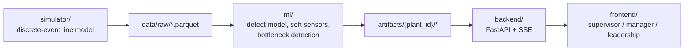
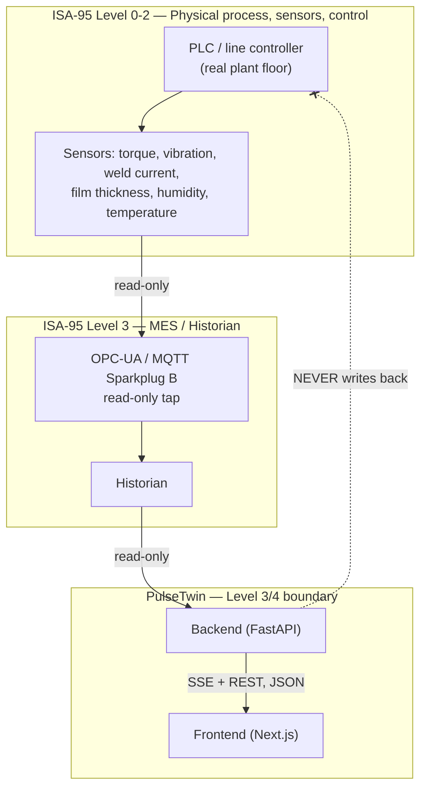

# PulseTwin

**A digital twin for a mixed-model automotive assembly line — advisory defect prediction, shifting-bottleneck detection, and ROI-justified instrumentation planning, without ever touching the real line.**

Accenture Innovation Challenge 2026 — Round 2

**Team:** Rishabh Yadav · Prashant Mishra · Mukul Hayaran

---

## Table of Contents

1. [Overview](#1-overview)
2. [Implementation Approach](#2-implementation-approach)
3. [Solution Architecture](#3-solution-architecture)
4. [Tech Stack & Dependencies](#4-tech-stack--dependencies)
5. [Setup & Execution Instructions](#5-setup--execution-instructions)
6. [Validation & Results](#6-validation--results)
7. [Repository Structure](#7-repository-structure)
8. [Known Limitations](#8-known-limitations)
9. [Team](#9-team)

---

## 1. Overview

PulseTwin is a decision-support layer for a mixed-model automotive
assembly line. It answers three questions a real plant asks every shift:

- **Is this unit at risk of a defect, and why?** — a calibrated
  probability with a plain-language explanation, not a black-box score.
- **Where is the line actually constrained right now, and where will it
  move next?** — bottleneck detection that adapts as tool wear shifts the
  constraint over time.
- **Is a given sensor investment worth it, and for which plant?** — a
  ranked, dollar-costed instrumentation plan, not a guess.

Because no team gets access to a real plant's historian for a hackathon,
PulseTwin includes its own seeded discrete-event simulator that generates
14 days of deliberately imperfect, realistic telemetry — correlated
sensor drift, stochastic breakdowns, a slowly shifting bottleneck, two
competing latent defect causes, and a delayed, imperfect inspection gate.
The ML pipeline, backend, and frontend are then built exactly as they
would be against a real historian feed, and a new plant is added by a new
config file with no code change.

**The one architectural rule everything else follows:** PulseTwin only
ever *reads*. It sits at the ISA-95 Level 3/4 boundary, consumes
historian data, and never writes back into a PLC, controller, or
historian tag — anywhere in the codebase. It cannot disrupt a live line
because it has no mechanism capable of touching it.

## 2. Implementation Approach

The system was built in four sequential layers, each depending only on
the one before it — so "regenerate the simulation" and "retrain the
model" stay independently runnable steps with a clean handoff:

```
simulator/  ->  ml/  ->  backend/  ->  frontend/
```

**Step 1 — Simulate a plant that behaves like a real one.**
`simulator/line_model.py` is an event-driven discrete-event engine
(`heapq`-based priority queue), not a fixed-tick or purely random
generator. Stations move through `working / blocked / starved / down`
states with finite inter-station buffers, MTBF-driven stochastic
breakdowns, lognormal repair times, and slow tool-wear drift — so a
shifting bottleneck and blocked/starved propagation are *emergent*
behavior of the model, not a labeled column someone hand-placed.
`simulator/causal_engine.py` layers two competing, only-sometimes-active
logistic defect modes on top, one of which depends on a genuinely
unobserved confounder (operator skill) — deliberately hard to invert
perfectly, the way a real causal system is.

**Step 2 — Turn raw telemetry into a leakage-safe feature matrix.**
`ml/featurize.py` enforces feature-leakage discipline physically, not
just by test: every raw table is filtered to stations at or before each
plant's `ml_feature_cutoff_station` *before* any feature is built, every
derived column is named so a regex test can verify the cutoff held, and
train/val/test splits are temporal by simulated day, never random.
`ml/soft_sensor.py` then adds virtual metrology (with honest prediction
intervals) for the plant's legacy, uninstrumented stations.

**Step 3 — Serve calibrated, explainable predictions.** `backend/`
precomputes everything expensive (features, calibrated probabilities,
bottleneck detection, permutation importances) once at FastAPI startup,
in the background, so the process never blocks on a training-style
workload at request time. Routers only ever do dict/DataFrame lookups.
Every prediction ships with a confidence interval, a measured-vs-inferred
provenance flag, and top-3 plain-language contributing factors (SHAP,
falling back to a permutation-based explainer).

**Step 4 — Make the numbers actionable for three different audiences.**
The Next.js frontend is not one dashboard but three persona views —
supervisor (what's happening right now), manager (where's the recurring
pain, what happens if I change something), leadership (is this worth the
money) — all reading the same live backend over REST and Server-Sent
Events.

Throughout, every dollar figure and probability threshold traces to a
named, sourced constant in `configs/economics.yaml` or a documented
constant in code — see `docs/ASSUMPTIONS.md` for the full list. Nothing
in the ROI or alerting logic is an unexplained magic number.

## 3. Solution Architecture



**ISA-95 / Purdue placement.** PulseTwin sits at the Level 3/4 boundary —
it reads from the historian (Level 3) and never writes downward to the
control layer (Level 0-2):



*(If your PDF exporter doesn't render Mermaid, the diagram source and a
rendered version are also viewable directly on GitHub, or in
`docs/ARCHITECTURE.md`.)*

**Key design decisions**

| Decision | Why |
|---|---|
| Event-driven simulator, not fixed-tick | Makes shifting bottlenecks and blocked/starved propagation real emergent behavior, not a scripted column |
| Interval-encoded telemetry | One row per station-state interval, not per second — matches how a real historian stores state changes, keeps a 14-day/42-station run compact |
| Physically-enforced leakage discipline | Every feature is built from data *before* the ML cutoff station, asserted by a regex-scanning test, not just a policy |
| Calibrated-probability-first API | Every prediction returns a probability + confidence interval + provenance + plain-language factors — never a bare score |
| SSE-only streaming | One directional channel; no client can push anything back through it |
| `/api/whatif` re-runs the real simulator | The what-if projection comes from actually running the discrete-event engine forward on a short slice, not a lookup table |
| Config-driven | Every station, variant, shift and dollar figure lives in `configs/*.yaml`; one plant ships (`plant_a.yaml`) |

## 4. Tech Stack & Dependencies

**Backend / ML** — Python 3.10+

| Package | Version | Purpose |
|---|---|---|
| `fastapi` | 0.141.1 | API framework |
| `uvicorn` | 0.52.4 | ASGI server |
| `pydantic` | 2.13.4 | Config & API schema validation |
| `pandas` / `pyarrow` | 2.3.3 / 25.0.1 | Data handling, Parquet I/O |
| `numpy` | 2.2.6 | Numerical computing |
| `scikit-learn` | 1.7.2 | `HistGradientBoostingClassifier`/`Regressor`, `IsotonicRegression`, permutation importance |
| `shap` | 0.49.1 | Prediction explanations |
| `sse-starlette` | 3.4.8 | Server-Sent Events streaming |
| `PyYAML` | 6.0.3 | Plant/economics config loading |
| `joblib` | 1.5.3 | Model artifact persistence |

Full pinned list: `backend/requirements.txt`.

**Frontend** — Node.js 18+

| Package | Version | Purpose |
|---|---|---|
| `next` | 16.3.3 | App framework (Turbopack) |
| `react` / `react-dom` | 19.2.8 | UI |
| `recharts` | ^3.10.1 | Charts (bottleneck timeline, waterfall, Pareto) |
| `tailwindcss` | ^4 | Styling |
| `typescript` | ^5 | Type checking |

Full list: `frontend/package.json`.

**Infrastructure** — Docker + `docker-compose` for containerized deployment; Parquet for all data at rest; no external database or paid API — the entire stack runs offline against committed data.

## 5. Setup & Execution Instructions

The repository ships with **already-generated data and trained
artifacts** (`data/raw/`, `artifacts/`), so the fastest path to a running
demo needs no training run and no simulation regeneration.

### Option A — Docker (recommended)

```bash
git clone <repo-url>
cd PulseTwin
make up
```

This runs `docker compose -f docker-compose.prod.yml up --build`: Postgres, Redis, MQTT,
the loader, the backend, ingestion and the frontend. The backend requires Postgres
(ADR-052) — there is no SQLite demo runtime. Once healthy:

- Frontend: **http://localhost:3000**
- Backend API: **http://localhost:7860**
- `make down` stops the stack (volumes included)

The free-tier cloud deploy is in `docs/PRODUCTION_ARCHITECTURE.md` §DEPLOY.

### Option B — Manual (no Docker)

```bash
# Backend
python3 -m venv venv
source venv/bin/activate
pip install -r backend/requirements.txt
PYTHONPATH=. uvicorn backend.main:app --host 0.0.0.0 --port 8000

# Frontend (separate terminal)
cd frontend
npm install
echo "NEXT_PUBLIC_API_BASE_URL=http://localhost:8000" > .env.local
npm run dev
```

Open **http://localhost:3000**.

### Regenerating data / retraining (optional — not required for the demo)

```bash
make generate   # re-runs the simulator, seed=42, ~10-20s per plant
make train      # retrains artifacts/{plant_id}/*, ~20s per plant
make test       # runs the test suite + frontend build check
```

## 6. Validation & Results

All numbers below are read from the committed artifact — reproducible via
`make generate && make train` with `seed=42`.

| Metric | Plant A |
|---|---|
| Stations / instrumented | 30 / 90% |
| True defect rate | 2.99% |
| Defect model PR-AUC (primary) | **0.256** |
| Measured oracle PR-AUC | 0.481 |
| Recall @ operating threshold | 27.6% |
| Bottleneck detection accuracy (self-consistency) | 85.9% |
| Forecast skill vs. naive persistence | +0.136 |

Full methodology, calibration
approach, masked-station soft-sensor validation, and known failure modes:
`docs/MODEL_CARD.md`.

## 7. Repository Structure

| Path | Contents |
|---|---|
| `configs/` | Plant and economics configs — single source of truth for every station, variant, shift, and dollar figure |
| `simulator/` | Discrete-event line model, causal defect engine, inspection gate, signal physics |
| `data/` | Committed simulator output (telemetry, checklists, genealogy, inspection, station-state segments) |
| `ml/` | Featurization, defect model, soft sensors, bottleneck detection, thresholds, temporal validation |
| `artifacts/` | Trained models, calibrators, and `metrics.json` per plant |
| `backend/` | FastAPI service — Pydantic API contract and routers |
| `frontend/` | Next.js app — `/supervisor`, `/manager`, `/leadership` |
| `tests/` | Leakage discipline, simulator, and soft-sensor tests |
| `docs/` | Architecture, assumptions, model card, demo script, this document |

## 8. Known Limitations

- All data is synthetic — a seeded discrete-event simulation, not a real
  plant feed.
- Soft-sensor accuracy is honestly weak on some signals — masked-station
  validation shows R² as low as **−2.50** for one station's vibration
  signal. Soft sensors help PR-AUC modestly, via checklist/dwell-time
  context, not by accurately reconstructing missing physical readings.
- Plant A's 0.256 PR-AUC is 53% of its measured 0.481 oracle ceiling. It is not tuned
  upward by making the simulator easier.
- One plant ships; transfer to a differently configured line is not measured (ADR-068).
- The ROI headline figure scales with an assumed annual unit volume and
  is explicitly flagged as an illustrative upper bound pending scrutiny
  of the scrap-vs-rework split assumption — the mechanism and every
  input are real and traceable; the dollar figure is not the thing to
  defend under hard questioning, the sourcing is.

## 9. Team

**Rishabh Yadav** · **Prashant Mishra** · **Mukul Hayaran**

Built for the Accenture Innovation Challenge 2026, Round 2.
