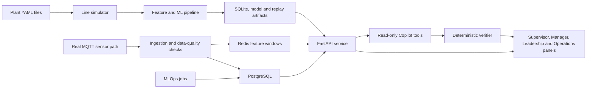

# Codebase overview

## What PulseTwin is

PulseTwin is a digital twin of a mixed-model vehicle assembly line. It combines events
from many stations to answer questions that one sensor cannot answer alone:

- Where is the current production bottleneck?
- Which vehicle is likely to have a defect before it reaches final inspection?
- Which other vehicles may share the same problem?
- Is a proposed buffer or cycle-time change likely to improve output?
- Is the model and its incoming data still trustworthy?

The app is advisory and read-only. It can recommend an inspection, hold, or process
change, but it cannot stop a line, change a machine setting, or promote a model without a
human action.

## The complete flow, in simple words

In local demo mode, the app replays committed JSON event files and reads SQLite. In the
production-shaped design, an MQTT ingestion service receives plant events, checks and
orders them, and writes to PostgreSQL while Redis holds short-lived feature windows.

## What each main folder does

| Folder | Plain-language purpose |
|---|---|
| `configs/` | Defines both plants, their stations, economics, alert rules, deployment, and data-governance rules. |
| `offline/simulator/` | Creates realistic vehicle journeys, station states, queues, sensor readings, and delayed defects. |
| `offline/ml/` | Builds time-safe features, trains and calibrates the defect model, finds alert thresholds, estimates missing sensors, and evaluates bottlenecks. |
| `offline/build_artifact.py` | Packages the prepared data into the files the demo can serve quickly. |
| `artifacts/` | Holds the ready-to-run SQLite database, NumPy model files, fallback models, and replay streams for both plants. |
| `serve/` | Provides the API used by every panel. It streams events, scores risk, returns analysis, enforces role checks, and records actions. |
| `frontend/` | The Next.js user interface: landing page, five tabs, shared components, charts, and API client. |
| `ingestion/` | The real-time MQTT-to-database bridge, including duplicate handling, late-event ordering, feature buffers, and data-quality checks. |
| `mlops/` | Detects drift, retrains a challenger, compares it with the champion, manages the model registry, and provides an SPC fallback. |
| `genai/` | Runs the Copilot's tool-using investigation and checks every numeric claim before it is shown. |
| `migrations/` | Creates and upgrades PostgreSQL tables for plant data, audit history, models, drift, and Copilot conversations. |
| `infrastructure/` | Contains Docker, Kubernetes, monitoring, network-policy, and Terraform deployment definitions. |
| `tests/` | Checks simulation, leakage, scoring parity, API behavior, roles, audit logging, ingestion, MLOps, and Copilot safety. |
| `docs/` and `reports/` | Record the architecture, assumptions, decisions, model limits, rollout plan, security posture, and verification reports. |

## How data reaches a screen

1. A plant configuration defines stations, sensors, zones, product variants, and shifts.
2. The simulator moves units through the line and creates station and sensor events.
3. The offline ML pipeline turns past events into model inputs without using future
   information.
4. The build step saves prepared results and a lightweight NumPy model.
5. The API reads those artifacts and serves live replay, unit detail, bottlenecks,
   metrics, ROI, what-if results, health data, and audit history.
6. The frontend calls the API and shows only the information suited to each role.
7. If the Copilot is used, it calls an approved set of API tools. A separate verifier
   then checks every number against the recorded tool result before the answer appears.

## The two plants

- **Plant A — Midwest Assembly:** 30 stations and Sedan, SUV, and EV production.
- **Plant B — Southern Truck:** 42 stations and Sedan, SUV, and Truck production.

The same code runs both plants, but each plant has its own model because its stations and
signals are different. Switching the plant picker changes the entire data context, not
just the name at the top of the page.

## Important words used across the panels

| Term | Simple meaning |
|---|---|
| Unit | One vehicle moving through the line. |
| Station | One work step, such as welding, painting, or final inspection. |
| Constraint or bottleneck | The station currently limiting the whole line's output. |
| WIP | Work in progress: vehicles currently inside the process. |
| UPH | Units per hour. Higher is more production output. |
| Risk | The model's estimated chance that a unit will later be found defective. |
| Lead time | Minutes remaining before the unit reaches the final inspection gate. |
| Measured | The value came from an actual sensor or recorded event. |
| Inferred | A soft sensor estimated the value because no reliable physical reading was available. |
| CI | Confidence interval: the reasonable low-to-high range around an estimate. |
| Alert budget | The maximum alert load a supervisor can realistically handle per shift; the configured value is six. |
| Champion | The model currently serving predictions. |
| Challenger | A newly trained model waiting for human comparison and approval. |
| Drift | Current data or model behavior has moved away from the conditions used for training. |
| PR-AUC | A model-quality measure useful when defects are rare. Higher is better, but it must be compared with the measured ceiling for this dataset. |

## Shared behavior in all tabs

- **Plant picker:** changes between Plant A and Plant B.
- **Role label:** shows which role is being sent to the API.
- **Freshness/offline state:** makes stale or unreachable data visible and offers retry
  behavior instead of silently showing old data as live.
- **Measured versus inferred:** inferred values use an amber label or hatch pattern; they
  are not made to look like sensor measurements.
- **Copilot dock:** available from persona pages. Manager, Leadership, and System roles
  can start a conversation. The Supervisor view explains why it is locked.
- **Audit confirmation:** after a mutating action, the UI confirms that the action was
  logged.

## Landing page and demo Login/Role page

The landing page introduces the problem, provides cards for Supervisor, Manager,
Leadership, and Operations, and shows API/database/artifact health when the backend is
reachable. Copilot is available from the dashboard navigation even though it does not
have a landing-page card.

The Login/Role page is a demonstration selector, not authentication. It stores the role
only in frontend memory, so a reload resets it. The fixed persona pages then identify
themselves explicitly: Supervisor sets Supervisor, Manager sets Manager, Leadership sets
Leadership, and the full Copilot page sets Manager. Operations is the page that lets the
viewer change roles and watch panels lock or unlock.

## Roles and access

The API uses a strict hierarchy:

`supervisor < manager < leadership < system`

Each higher role can access the lower role's capabilities. Important examples are:

| Role | Additional access |
|---|---|
| Supervisor | Floor alerts, containment, feedback, acknowledgements, and basic line information. |
| Manager | What-if simulation, full system status, shift summaries, and Copilot runs. |
| Leadership | Economics, instrumentation planning, model health, registry, and audit history. |
| System | Retraining, promotion, rollback, and other model administration. |

The demo sends the role in an `X-PulseTwin-Role` header. The server really enforces the
role checks, but there is no password or identity provider in front of the header. A
production deployment would replace this with an Azure AD or Okta token.

## Trust and safety rules that shape the product

- **No factory write-back:** recommendations always need a person to act.
- **No hidden provenance:** estimated values are marked as inferred and should include a
  range.
- **No operator ranking:** the app uses shift, team, or anonymous group information, not
  named worker performance.
- **Sourced money:** economic values are tied to a source or stated assumption.
- **Human attention is treated as limited:** the economic threshold would create far too
  many alerts, so the live system uses the six-alert-per-shift budget and shows the value
  being left on the table.
- **The Copilot is not trusted by default:** unverifiable numeric claims are removed; a
  badly structured or insufficiently supported finding is rejected completely.
- **Heavy ML stays offline:** the serving API does not train models or import the large
  data-science libraries used by the offline and MLOps jobs.

## Honest limitations to remember

- This repository contains simulated plant data, not a connection to a real factory.
- The production Docker stack and deployment manifests are designed and tested in parts,
  but the full production stack is documented as not yet verified end to end.
- The demo has authorization rules but no real authentication.
- Plant B's defect recall is materially lower than Plant A's at the same attention
  budget.
- The Plant A model identifies an at-risk group but cannot meaningfully rank risk inside
  that group; this is why the Supervisor alert feed is ordered by time.
- Soft sensors work very well for ambient paint signals but poorly for independent tool
  wear such as torque and vibration. The negative result is kept visible.
- The Copilot may use an external model when a credential exists; without one it uses a
  deterministic rule-based path with the same tools and verifier.

## Entry points for developers

- Frontend navigation: `frontend/components/ui/AppShell.tsx`
- Frontend API contract: `frontend/lib/api.ts`
- Main runtime API: `serve/main.py` and `serve/routers/`
- Local database selection: `serve/db.py`
- Simulator entry point: `offline/simulator/generate.py`
- Training entry point: `offline/ml/train.py`
- Artifact build: `offline/build_artifact.py`
- Real-time ingestion: `ingestion/mqtt_subscriber.py`
- MLOps retraining: `mlops/retrainer.py`
- Copilot loop and verification: `genai/loop.py` and `genai/verifier.py`
